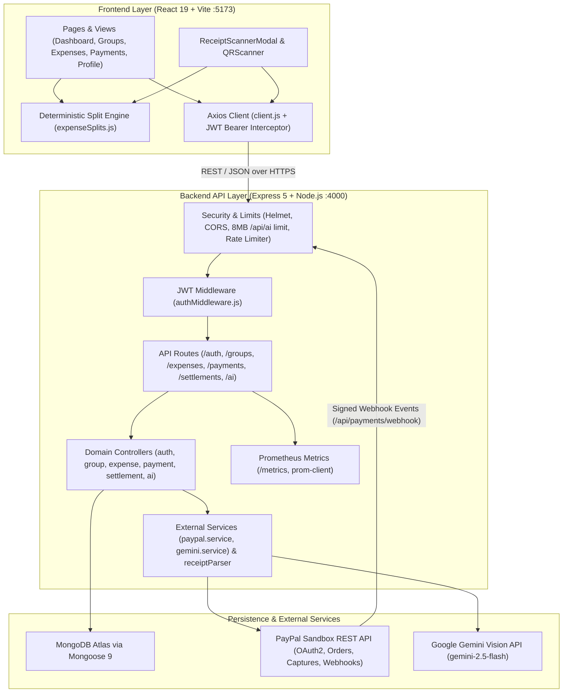
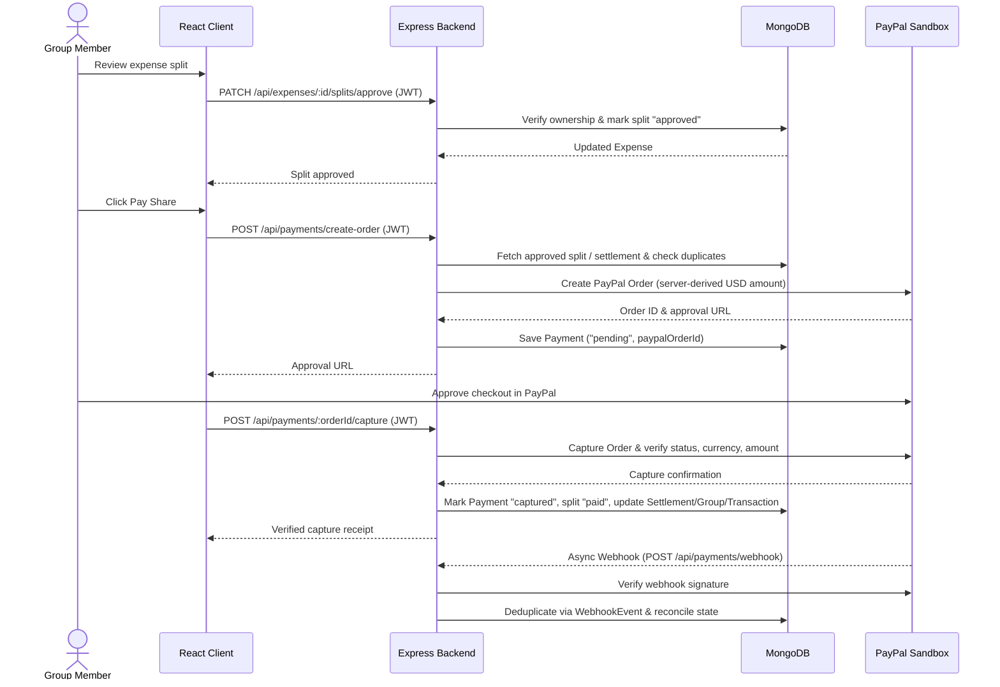
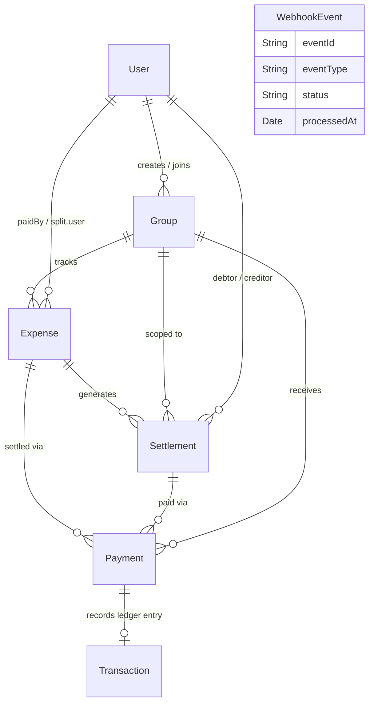

# ALLIN

**Collaborative Payments & Shared Expense Management Platform**

ALLIN is a full-stack collaborative expense-tracking and shared-payment platform. It combines group pool management, deterministic expense splitting, Gemini Vision AI itemized receipt scanning, server-verified PayPal Sandbox checkout, settlement tracking, and Prometheus observability.

---

## System Architecture

### High-Level Component Architecture



### Architecture Layers Explained

1. **Frontend Presentation & Deterministic Calculation Layer (`client/src/`)**
   - **Routing & State:** Built with React 19 and React Router 7 (`WelcomePage`, `LoginPage`, `RegisterPage`, and JWT-protected `DashboardPage`). `AuthContext` persists and hydrates the authenticated session via `authService.js`.
   - **Dashboard Modules:** `PaymentOverview`, `StatCard`, `Contributions`, `Transactions`, `GroupsView`, `GroupModal`, `ExpenseTracker`, `PaymentsView`, `ProfileView`, `QRScanner`, and `ReceiptScannerModal`.
   - **Client Split Math (`client/src/utils/expenseSplits.js`):** Computes equal, custom, and itemized receipt splits in **integer cents** before submission so totals always reconcile to the exact cent without floating-point drift.

2. **API Gateway, Security & Observability Layer (`server/src/app.js`, `server/src/middleware/`)**
   - **Hardening:** `helmet()` HTTP headers, credential-aware CORS origin allowlist (`CLIENT_URL`, `localhost:5173`, `localhost:4000`, `localhost:3000`), and `authMiddleware.js` (`protect`) JWT verification on all mutation and private read routes.
   - **Payload & Abuse Guardrails:** Dedicated `8mb` JSON body limit on `/api/ai` (enforcing a 5 MB decoded image cap) plus `receiptScanRateLimiter` (`rateLimit.js`, default 12 requests/minute per user/IP).
   - **Observability (`server/src/config/metrics.js`):** Collects default Node.js metrics alongside `allin_http_request_duration_seconds`, `allin_payments_total`, and `allin_expenses_total` at `GET /metrics`.

3. **Domain Controllers & Financial Integrity Layer (`server/src/controllers/`)**
   - **Expenses & Splits (`expense.controller.js`):** Validates group membership, supports `personal` and `pool` funding (`paymentSource`), enforces per-user split approval (`PATCH /api/expenses/:id/splits/approve`), and derives group payment progress from persisted split states.
   - **Payments & Reconciliation (`payment.controller.js`):** Never trusts client-supplied payment amounts, currencies, or statuses. Payable amounts are looked up exclusively from stored `Expense.splits` or `Settlement` records on the server, verified against PayPal's capture response, and guarded against duplicate orders and duplicate webhooks.
   - **AI Parsing Pipeline (`ai.controller.js`, `gemini.service.js`, `receiptParser.js`):** Calls Gemini Vision with strict structured JSON instructions, validates and normalizes returned items/totals, and leaves final member allocation and split math deterministic rather than AI-computed.

4. **Database Persistence Layer (`server/src/models/`)**
   - Stores strongly linked `User`, `Group`, `Expense` (with embedded `splits`), `Settlement`, `Payment`, `Transaction`, and `WebhookEvent` collections in MongoDB.

---

## Core Workflows

### 1. Shared Expense Split Approval & PayPal Payment Lifecycle



### 2. AI Receipt-to-Itemized-Split Flow

```mermaid
flowchart LR
    A["Upload / Photo Receipt (JPG, PNG, WebP)"] --> B["POST /api/ai/parse-receipt (JWT + Rate Limiter)"]
    B --> C["Gemini Vision API (gemini.service.js)"]
    C --> D["JSON Validation & Normalization (receiptParser.js)"]
    D --> E["Interactive Item Editor (ReceiptScannerModal.jsx)"]
    E --> F["Integer-Cent Split Calculation (expenseSplits.js)"]
    F --> G["Preview & Explicit Confirmation"]
    G --> H["POST /api/expenses (Existing Expense & Approval Flow)"]
```



- **Zero AI Financial Math:** Gemini only extracts raw merchant, date, currency, items, tax, tip, and discount fields. Proportional tax/tip/discount allocation and member shares are computed deterministically in integer cents by `expenseSplits.js` so member shares sum exactly to the receipt total.
- **Manual Fallback:** If an image is unclear, rate-limited, or Gemini is unavailable, the user can immediately switch to manual entry inside the modal.

### 3. Data Model Relationships



- **Expenses (`expense.js`):** Embed `splits[]` (`user`, `amount`, `status`: `pending | approved | paid`, `approvedAt`, `paidAt`), `paymentSource` (`personal | pool`), `status` (`pending | paid | partially_paid | cancelled`), and soft-delete fields (`deletedAt`, `deletedBy`).
- **Groups (`Group.js`):** Track `targetAmount`, `poolBalance`, `collectedAmount`, `inviteCode`, `members[]`, and `status` (`active | closed`).
- **Payments & Transactions (`payment.js`, `transaction.js`):** Support `GROUP_CONTRIBUTION`, `EXPENSE_ADVANCE`, and `REIMBURSEMENT` flows while maintaining an immutable audit trail (`CONTRIBUTION`, `POOL_EXPENSE`, `PERSONAL_ADVANCE`, `REIMBURSEMENT`).
- **Webhook Idempotency (`webhookEvent.js`):** Tracks PayPal `eventId` uniquely so retried webhook deliveries are processed once.

---

## Tech Stack

### Frontend (`client/`)
- **Framework:** React 19, Vite 8, React Router 7
- **Styling & Icons:** Tailwind CSS 4 (`@tailwindcss/vite`), scoped CSS (`App.css`), `lucide-react`
- **Networking & Utilities:** `axios`, `html5-qrcode`
- **Linting:** `oxlint`

### Backend (`server/`)
- **Runtime & Framework:** Node.js (ES Modules), Express 5
- **Database:** MongoDB Atlas / Mongoose 9
- **Security & Auth:** `jsonwebtoken`, `bcryptjs`, `helmet`, `cors`
- **AI & Payments:** Google Gemini Vision REST API (`gemini-2.5-flash` default), PayPal Sandbox REST API
- **Monitoring & Testing:** `prom-client`, Jest 30, Supertest 7, Nodemon

---

## Project Structure

```text
ALLIN/
├── package.json                  # Root helper scripts (server, client, build, test, lint)
├── client/                       # React + Vite frontend
│   ├── .env.example
│   ├── vite.config.js            # Dev server (:5173) and /api proxy (:4000)
│   ├── tests/
│   │   └── expenseSplits.test.js # Deterministic split unit tests
│   └── src/
│       ├── api/                  # Axios client setup
│       ├── components/
│       │   ├── auth/             # ProtectedRoute, SplashScreen
│       │   ├── common/           # Button, Input, Logo
│       │   └── dashboard/        # PaymentOverview, ExpenseTracker, ReceiptScannerModal, QRScanner,
│       │                         # GroupsView, GroupModal, PaymentsView, ProfileView,
│       │                         # Contributions, Transactions, StatCard, Header, Sidebar
│       ├── context/              # AuthContext
│       ├── pages/                # WelcomePage, LoginPage, RegisterPage, DashboardPage
│       ├── services/             # authService, groupService, expenseService, paymentApi, aiService
│       └── utils/                # expenseSplits, currency
└── server/                       # Express + Mongoose backend
    ├── .env.example
    ├── tests/
    │   ├── aiReceipt.test.js
    │   ├── app.test.js
    │   ├── expenseGroupImprovements.test.js
    │   ├── financialSplittingAndSettlements.test.js
    │   ├── integration.test.js
    │   └── sharedPayment.test.js
    └── src/
        ├── config/               # MongoDB connection & Prometheus metrics
        ├── controllers/          # authController, groupController, expense.controller,
        │                         # payment.controller, settlement.controller, ai.controller
        ├── middleware/           # authMiddleware, rateLimit
        ├── models/               # User, Group, expense, payment, settlement, transaction, webhookEvent
        ├── routes/               # authRoutes, groupRoutes, expenseRoutes,
        │                         # payment.route, settlementRoutes, aiRoutes
        ├── services/             # gemini.service, paypal.service
        ├── utils/                # receiptParser
        ├── app.js                # Express app configuration
        └── server.js             # Entry point (default port 4000)
```

---

## Getting Started

### 1. Prerequisites
- **Node.js** (v18+ recommended; uses native `fetch` and ES Modules)
- **npm**
- **MongoDB** connection URI (e.g., MongoDB Atlas)
- **PayPal Developer Sandbox** credentials (`PAYPAL_CLIENT_ID`, `PAYPAL_CLIENT_SECRET`)
- **Google Gemini API Key** (`GEMINI_API_KEY`) for AI receipt scanning (optional for other features)

### 2. Install Dependencies

```bash
npm install
npm --prefix server install
npm --prefix client install
```

### 3. Configure Environment Variables

Copy the example environment files and populate your credentials:

```bash
cp server/.env.example server/.env
cp client/.env.example client/.env
```

**`server/.env`**
```env
PORT=4000
NODE_ENV=development
CLIENT_URL=http://localhost:5173

MONGO_URI=mongodb+srv://<username>:<password>@<cluster>.mongodb.net/<database>?retryWrites=true&w=majority
JWT_SECRET=your_super_secret_jwt_key_here

PAYPAL_CLIENT_ID=your_paypal_sandbox_client_id
PAYPAL_CLIENT_SECRET=your_paypal_sandbox_client_secret
PAYPAL_BASE_URL=https://api-m.sandbox.paypal.com

GEMINI_API_KEY=your_gemini_api_key_here
GEMINI_MODEL=gemini-2.5-flash
```

**`client/.env`**
```env
VITE_API_BASE_URL=http://localhost:4000
```

> **Port Note:** Keep `PORT` in `server/.env` aligned with `VITE_API_BASE_URL` in `client/.env` and the `/api` proxy target in `client/vite.config.js` (default `4000`). If you run the backend on `3000`, update `VITE_API_BASE_URL` and `client/vite.config.js` to match.

### 4. Run Locally

Start the backend and frontend in separate terminals from the project root:

```bash
# Terminal 1: Start Express backend (nodemon)
npm run server

# Terminal 2: Start Vite frontend dev server
npm run client
```

- **Frontend:** `http://localhost:5173`
- **Backend API:** `http://localhost:4000` (or the `PORT` configured in `server/.env`)
- **Health Check:** `GET /api/health`
- **Prometheus Metrics:** `GET /metrics`

---

## API Overview

| Prefix / Path | Endpoints | Auth | Description |
| --- | --- | --- | --- |
| `/api/auth` | `POST /register`, `POST /login`, `GET /me`, `POST /me` | Public / JWT (`me`) | User registration, login, and profile lookup |
| `/api/groups` | `POST /`, `GET /`, `POST /join`, `GET /:id`, `GET /:id/contributions`, `PATCH /:id/close`, `DELETE /:id` | JWT | Group creation, invite-code join, contributions, lifecycle |
| `/api/expenses` | `GET /`, `GET /summary`, `GET /:id`, `POST /`, `PUT /:id`, `DELETE /:id`, `PATCH /:id/splits/approve` | Optional read / JWT write | Expense CRUD, category analytics, split approval |
| `/api/payments` | `POST /create-order`, `POST /:orderId/capture`, `POST /webhook`, `GET /transactions` | JWT / Verified Webhook | PayPal order creation/capture, webhook reconciliation, history |
| `/api/settlements` | `GET /`, `GET /:id` | JWT | Member debt/credit settlement tracking |
| `/api/ai` | `POST /parse-receipt` | JWT + Rate Limit | Gemini Vision receipt extraction (`8mb` JSON body limit) |
| `/health`, `/api/health` | `GET` | Public | Service health check |
| `/metrics` | `GET` | Public | Prometheus metrics scrape endpoint |

---

## Testing & Linting

```bash
# Run all backend Jest test suites (from project root)
npm test

# Run frontend split-calculation unit tests
node --test client/tests/expenseSplits.test.js

# Lint frontend code (oxlint)
npm run lint

# Build frontend production bundle
npm run build
```

---

## Security Notes
- Never commit `server/.env` or `client/.env` containing real MongoDB URIs, JWT secrets, PayPal credentials, or Gemini API keys.
- All PayPal order amounts, split approvals, and webhook updates are validated server-side against stored database records and cryptographic PayPal webhook signatures.
